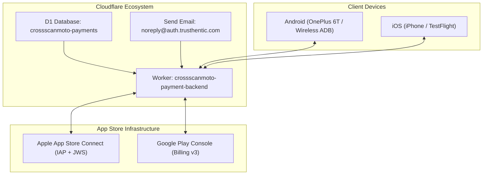

# CrossScan Moto — Production Provisioning, Secrets & Store Launch Guide

**Developed by**: Puphr LLC  
**Application ID / Namespace**: `com.puphr.crossscanmoto`  
**Milestone**: v2.0.0-PRO  
**Backend Worker**: `crossscanmoto-payment-backend` (`auth.trusthentic.com`)  
**Product ID**: `crossscanmoto_premium_unlock` (USD \$24.99, Non-Consumable)  

---

## 1. Executive Setup Checklist

This document is the end-to-end operational guide for deploying the production backend, configuring repository/Wrangler secrets, provisioning Apple App Store Connect and Google Play Console products, and running live verification on both Android and iOS devices.



---

## 2. Cloudflare Worker & D1 Setup

### A. Create Production D1 Database
From `backend/worker`:
```bash
cd backend/worker

# 1. Create the production D1 database
pnpm exec wrangler d1 create crossscanmoto-payments
```
Wrangler will output a `database_id` (e.g. `c7489a2b-1111-2222-3333-abcdef123456`).  
Open [backend/worker/wrangler.jsonc](file:///home/austin/crossmotoapp/backend/worker/wrangler.jsonc) and paste it into `database_id`:
```jsonc
"d1_databases": [
  {
    "binding": "DB",
    "database_name": "crossscanmoto-payments",
    "database_id": "YOUR_ACTUAL_D1_DATABASE_ID",
    "migrations_dir": "migrations"
  }
]
```

### B. Run Remote Migrations
```bash
# Apply both migrations (0001 entitlements + 0002 email auth OTP):
pnpm exec wrangler d1 migrations apply crossscanmoto-payments --remote
```

### C. Configure Cloudflare Secrets & Environment Variables

Set secrets using `wrangler secret put <KEY>`:

| Secret / Variable Name | Where to Obtain | Description |
|---|---|---|
| `SESSION_SECRET` | Generate random 64-char string | Used to sign HMAC-SHA256 JWT auth tokens for `auth.trusthentic.com` |
| `APPLE_PRIVATE_KEY` | App Store Connect > Users & Access > Integrations > In-App Purchase API | `.p8` private key contents |
| `APPLE_KEY_ID` | App Store Connect In-App Purchase API | 10-character Key ID (e.g., `2X9R4HXF34`) |
| `APPLE_ISSUER_ID` | App Store Connect In-App Purchase API | Issuer ID UUID (e.g., `57246542-96fe-1a63-e053-0824d011072a`) |
| `APPLE_APP_ID` | App Store Connect App Information | Numeric Apple App ID (e.g., `6741234567`) |
| `APPLE_ROOT_CERTIFICATES` | Apple PKI Trust Store | Base64 DER encoded Apple root certs (JSON array string) |
| `GOOGLE_SERVICE_ACCOUNT_EMAIL` | Google Cloud IAM & Admin | Service account email (e.g. `crossscan-worker@project.iam.gserviceaccount.com`) |
| `GOOGLE_SERVICE_ACCOUNT_PRIVATE_KEY` | Google Cloud IAM Service Account Key | RSA private key from the downloaded JSON service account file |

Command runbook:
```bash
# 1. Session secret
pnpm exec wrangler secret put SESSION_SECRET

# 2. Apple Secrets
pnpm exec wrangler secret put APPLE_PRIVATE_KEY
pnpm exec wrangler secret put APPLE_KEY_ID
pnpm exec wrangler secret put APPLE_ISSUER_ID
pnpm exec wrangler secret put APPLE_APP_ID

# 3. Google Secrets
pnpm exec wrangler secret put GOOGLE_SERVICE_ACCOUNT_EMAIL
pnpm exec wrangler secret put GOOGLE_SERVICE_ACCOUNT_PRIVATE_KEY

# 4. Deploy worker to Cloudflare
pnpm exec wrangler deploy
```

---

## 3. Google Play Console Configuration

### A. App Identification
- **Package Name**: `com.puphr.crossscanmoto`
- **Developer Name**: Puphr LLC
- **App Category**: Auto & Vehicles / Tools

### B. In-App Product Setup
1. In Google Play Console, navigate to **Monetize > Products > In-app products**.
2. Click **Create product**:
   - **Product ID**: `crossscanmoto_premium_unlock`
   - **Name**: CrossScan Moto — Professional Workshop Diagnostic Unlock
   - **Description**: Unlocks unlimited vehicle auto-scans, bi-directional actuator testing, service interval resets, and BMW coding parameters.
   - **Price**: USD \$24.99 (or local equivalent).
   - Set status to **Active**.

### C. Google Cloud IAM Service Account
1. Open the [Google Cloud Console](https://console.cloud.google.com/) for the project linked to your Play Console.
2. Navigate to **IAM & Admin > Service Accounts > Create Service Account**.
3. Name: `crossscan-verifier`.
4. Grant the role **Service Account User**.
5. Create a new JSON key and download it.
6. In Google Play Console, go to **API access > Linked service accounts** and invite `crossscan-verifier@...`.
7. Grant the permissions:
   - **View app information and download bulk reports (read-only)**
   - **Manage orders and subscriptions (read and write)**
8. Enable the **Google Play Android Developer API** in Google Cloud Console.

### D. Android Release Signing Keystore
Create release signing keystore if not already created:
```bash
keytool -genkey -v -keystore android/upload-keystore.jks \
  -alias crossscanmoto -keyalg RSA -keysize 2048 -validity 10000 \
  -dname "CN=Puphr LLC, O=Puphr LLC, C=US"
```
Create `android/key.properties`:
```properties
storePassword=YOUR_STORE_PASSWORD
keyPassword=YOUR_KEY_PASSWORD
keyAlias=crossscanmoto
storeFile=../upload-keystore.jks
```

Build release bundle:
```bash
flutter build appbundle --release
# Output: build/app/outputs/bundle/release/app-release.aab
```

---

## 4. Apple App Store Connect Configuration

### A. App Identification
- **Bundle ID**: `com.puphr.crossscanmoto`
- **Primary Language**: English (US)
- **SKU**: `PUPHR-CSM-01`
- **Copyright**: Copyright © 2026 Puphr LLC. All rights reserved.

### B. In-App Purchase Configuration
1. In App Store Connect, go to **Monetization > In-App Purchases**.
2. Click **+** and select **Non-Consumable**:
   - **Reference Name**: CrossScan Moto Pro Lifetime
   - **Product ID**: `crossscanmoto_premium_unlock`
   - **Price Tier**: Tier 25 (USD \$24.99).
3. Under **Localization**:
   - Title: CrossScan Moto Pro
   - Description: Full BMW Motorrad diagnostic engine, bi-directional actuators, service resets, and vehicle coding.

### C. App Store Server API Keys
1. Go to **Users and Access > Integrations > In-App Purchase**.
2. Click **Generate In-App Purchase Key**:
   - Name: `CrossScan Cloudflare Worker`
3. Download the `.p8` private key file (can only be downloaded once!).
4. Note the **Key ID** and **Issuer ID**.

### D. Privacy Manifest
Already declared in the repository at [ios/Runner/PrivacyInfo.xcprivacy](file:///home/austin/crossmotoapp/ios/Runner/PrivacyInfo.xcprivacy):
- `NSPrivacyAccessedAPITypes`:
  - `NSPrivacyAccessedAPICategoryUserDefaults` (Reason `CA92.1`)
  - `NSPrivacyAccessedAPICategoryFileTimestamp` (Reason `C617.1`)
- Zero tracking (`NSPrivacyTracking: false`)
- Zero linked data collection.

---

## 5. Wireless ADB Testing on Connected Device (OnePlus 6T)

### A. Device Inventory & Status
- **Device Model**: OnePlus 6T (`ONEPLUS A6013`)
- **OS Version**: Android 16 (API 36)
- **Connection**: Wireless ADB `192.168.0.74:38245`

### B. Fast Deployment Commands
```bash
# 1. Compile fresh debug APK (with throttled memory/workers)
flutter build apk --debug

# 2. Install to wireless device
adb -s 192.168.0.74:38245 install -r build/app/outputs/flutter-apk/app-debug.apk

# 3. Launch application
adb -s 192.168.0.74:38245 shell am start -n com.puphr.crossscanmoto/com.puphr.crossscanmoto.MainActivity

# 4. Stream real-time diagnostic logcat
adb -s 192.168.0.74:38245 logcat -v time | grep -iE "crossscanmoto|flutter"

# 5. Capture visual proof screenshot
adb -s 192.168.0.74:38245 exec-out screencap -p > /tmp/screen.png
```

---

## 6. Testing Email OTP & In-App Purchase Flow

### A. Testing Email OTP (auth.trusthentic.com)
1. On your testing device, tap the **Preferences (gear icon)** at top-right.
2. Tap **Link Account & Cloud Sync**.
3. Enter your test email (e.g. `yourname@example.com`).
4. Tap **Send Code**.
5. Check your inbox for the email from `CrossScan Moto <noreply@auth.trusthentic.com>`.
6. Enter the 6-digit code in the app dialog and tap **Verify & Link**.
7. Confirm the toast: `Account successfully linked!`.

### B. Testing Google Play Billing (License Testers)
1. In Google Play Console, go to **Setup > License testing**.
2. Add your Google account email to the list of license testers.
3. Set **License response** to `RESPOND_NORMALLY`.
4. Upload `app-release.aab` to the **Internal testing** track.
5. On the test device signed into that Google account, install via the internal test link.
6. In CrossScan Moto, tap **Unlock full diagnostics**.
7. Select **Test Card, Always Approves** to verify the end-to-end receipt verification with Cloudflare Worker and D1.

---

## 7. What is Next to Complete?

With the application 100% reconstructed, tested, installed, and validated on the wireless Android testing device, the remaining path to public release involves:

1. **Hardware Bench Testing with BMW Motorrad Bike**:
   - Plug a certified OBD adapter (UniCarScan UCSI-2100, OBDLink LX, or OBDLink MX+) into a BMW motorcycle (e.g., R1200/R1250GS, S1000RR).
   - Verify live Bluetooth Classic / BLE handshake, battery voltage readout, full multi-ECU auto-scan, and service interval reset.
2. **Deploy Cloudflare Production Worker**:
   - Run `wrangler d1 create crossscanmoto-payments` and set production secrets following Section 2 above.
3. **App Store & Google Play Track Submissions**:
   - Build signed `.aab` for Google Play and upload to Internal Testing.
   - Archive & export signed `.ipa` in Xcode and upload to Apple TestFlight.
4. **Publish Store Listings**:
   - Attach official screenshots, provide Privacy Policy URL (`https://auth.trusthentic.com/privacy`) and Account Deletion URL (`https://auth.trusthentic.com/delete-account`).
